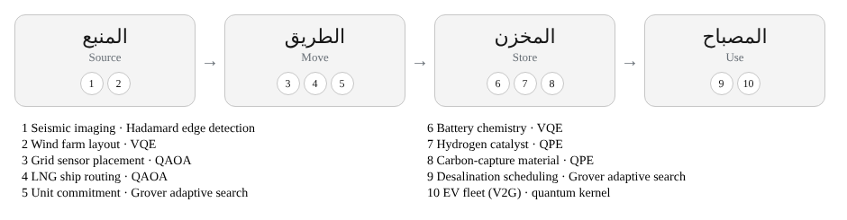

# Quantum Journey from Energy Source to Sustainability · رحلة الكم من مصدر الطاقة إلى الاستدامة
### تحدي الحوسبة الكمية 2026 · KACST Qiskit Fall Fest 2026, Riyadh · 22–23 November

*Prepared by Ahmed Elghadban, [Quantumy](https://quantumy.ai).*<br><sub>Reviewed by Ola Tarig.</sub>

**«من المنبع إلى المصباح»** · From the wellspring to the lamp.

Energy makes one journey before it lights a lamp: it is found, it is moved, it is stored and used. Ten teams each take one moment of that journey, a problem that is hard for ordinary computers at full scale, and learn one quantum algorithm on a small example. The four stops are **المنبع Source · الطريق Move · المخزن Store · المصباح Use**. Each team builds a Qiskit notebook and a product **in Arabic** that teaches its use case and its algorithm together.



## 1 · Find your notebook

Team number = challenge number.

| Team | Stop | Use case | Algorithm | Notebook |
|---|---|---|---|---|
| 1 | Source | Seismic imaging, feature sharpening | Quantum Hadamard edge detection | [01](https://colab.research.google.com/github/QTACInstitute/Quantum-Coding-Challenge/blob/main/notebooks/01_source_seismic_edges.ipynb) |
| 2 | Source | Wind farm layout | VQE | [02](https://colab.research.google.com/github/QTACInstitute/Quantum-Coding-Challenge/blob/main/notebooks/02_source_wind_farm_vqe.ipynb) |
| 3 | Move | Grid sensor placement | QAOA | [03](https://colab.research.google.com/github/QTACInstitute/Quantum-Coding-Challenge/blob/main/notebooks/03_move_grid_sensors_qaoa.ipynb) |
| 4 | Move | LNG ship routing | QAOA | [04](https://colab.research.google.com/github/QTACInstitute/Quantum-Coding-Challenge/blob/main/notebooks/04_move_lng_routing_qaoa.ipynb) |
| 5 | Move | Unit commitment | Grover adaptive search | [05](https://colab.research.google.com/github/QTACInstitute/Quantum-Coding-Challenge/blob/main/notebooks/05_move_unit_commitment_grover.ipynb) |
| 6 | Store | Battery cathode chemistry | VQE | [06](https://colab.research.google.com/github/QTACInstitute/Quantum-Coding-Challenge/blob/main/notebooks/06_store_battery_vqe.ipynb) |
| 7 | Store | Hydrogen electrolysis catalyst | QPE | [07](https://colab.research.google.com/github/QTACInstitute/Quantum-Coding-Challenge/blob/main/notebooks/07_store_hydrogen_qpe.ipynb) |
| 8 | Store | Carbon-capture material | QPE | [08](https://colab.research.google.com/github/QTACInstitute/Quantum-Coding-Challenge/blob/main/notebooks/08_store_carbon_capture_qpe.ipynb) |
| 9 | Use | Desalination scheduling | Grover adaptive search | [09](https://colab.research.google.com/github/QTACInstitute/Quantum-Coding-Challenge/blob/main/notebooks/09_use_desalination_grover.ipynb) |
| 10 | Use | EV fleet (V2G) | Quantum kernel classifier | [10](https://colab.research.google.com/github/QTACInstitute/Quantum-Coding-Challenge/blob/main/notebooks/10_use_ev_fleet_kernel.ipynb) |

The links open the notebook in Google Colab (they work once the notebooks are on the `main` branch).

## 2 · Run it

**Colab.** Click your link, then run the first code cell. It clones this repository and installs the pinned packages (about a minute). No account other than Google is needed.

**Laptop.**
```
python -m venv .venv
source .venv/bin/activate          # Windows: .venv\Scripts\activate
pip install -r requirements.txt
pip install jupyterlab
jupyter lab                        # open notebooks/<your file>
```
Everything runs on a CPU simulator. No quantum computer and no account are needed. Runs are seeded (`qff.SEED = 2026`), so you should see the same numbers as your neighbours.

## 3 · How a notebook is laid out

Every notebook has the same seven sections.

| Section | What | When |
|---|---|---|
| 0 · The journey so far | The four-stop map with your stop lit (identical in all ten) | Day 1 |
| 1 · This stop | The use case, who faces it, what is real today | Day 1 |
| 2 · Made small | The toy instance; the classical baseline runs first | Day 1 |
| 3 · The algorithm | The idea, then guided Qiskit cells and **three team tasks** (T1 warm-up, T2 core step, T3 stretch) | Day 2 |
| 4 · Compare | Quantum against classical; what the toy shows and does not show | Day 2 |
| 5 · Build the explainer | The brief for your Arabic product (up to 5 minutes, any format) | Day 2 |
| 6 · Pitch | The 5-minute structure, likely questions, a checklist | Day 2 |

Each task cell starts with `# TODO (team) Tn` and is followed by a `# Self-check` cell of plain `assert`s with readable messages. The starter notebook stops with `NotImplementedError("T1: ...")` at the first task you have not done. That is intended.

**You do not need the internet to finish.** Every notebook teaches its own maths in section 3 (numbered equations, each one checked in a code cell), and gives you three kinds of help:

- a **🧰 Toolbox** just before the first task: a small table and one runnable cell that show how every Qiskit and `qff` call you will need is written, on a toy example;
- before each task, a short "what you are about to build and why" and the formula it implements;
- three **hints** you can open one at a time (a nudge, the structure, a skeleton with blanks). The hints never contain the answer.

In notebooks 02, 03 and 04, task T2 comes with two routes. The **easier route** (the default) gives you the plumbing and leaves a few blanks marked `______` that carry the ideas. The **challenge route** is to delete that scaffold and write the whole cell yourself.

## 4 · The rubric

| Part | Weight | Fed by |
|---|---|---|
| Qiskit integration and code | 10% | Section 3, your completed notebook |
| Product (in Arabic, at most 5 minutes) | 50%: accuracy 17, conceptual insight in Arabic 17, creativity 11, execution 5 | Sections 1 and 2 (accuracy), 3 and 4 (insight), 5 (creativity, execution) |
| Presentation (5 minutes) | 40% | Section 6 |

## 5 · The honesty rule

As of November 2026 nobody has shown a classically benchmarked quantum advantage on any of these ten problems. Say clearly what your small example shows and what it does not show, and run the classical baseline first.

## 6 · Arabic terminology

Use the glossary cell at the end of section 3 of your notebook, and [quantabic.com](https://quantabic.com). Use Quantabic's terms where they exist. Glossary entries marked tier I are proposals that still need checking against Quantabic. The Arabic in your product is yours.

## 7 · The shared helper package `qff/`

Small, readable Python used by all notebooks. One line per function with an example is in [qff/README.md](qff/README.md). Quick tour:

```python
import qff
qff.bits.to_x("110")                      # [0, 1, 1]: count strings are little-endian, never index them by hand
qff.classical.brute_force(qp)             # best x, best value, full table
qff.quantum.qaoa_energy(ansatz, diag)     # theta -> <C>, exact
qff.chem.load_hamiltonian(f"{DATA}/lih_parity_1.6.json")
```

## 8 · Credits and sources

- Prepared by **Ahmed Elghadban**, [Quantumy](https://quantumy.ai).
  - Reviewed and tested by Ola Tarig.
- [Quantumy](https://quantumy.ai) works on quantum-safe security for enterprises and critical infrastructure. Its aim, in its own words: "Making quantum technology understandable, useful, and safe."
- [The Mustafa Project · مشروع مصطفى](https://mustafaproject.quantumy.ai) is Quantumy's non-profit initiative, opening quantum science to everyone and to Arabic speakers in particular. It is coming soon.
- The use cases follow the World Economic Forum and Aramco paper on quantum computing use cases in the energy sector; each notebook gives the case number and page and states which method the paper uses and which one we teach. The toy numbers in the notebooks are invented for teaching.
- Qiskit and its documentation: [docs.quantum.ibm.com](https://docs.quantum.ibm.com).
- Event partners: KACST, SQCA, Academy 32, IBM Quantum, with QSaudi mentors.
